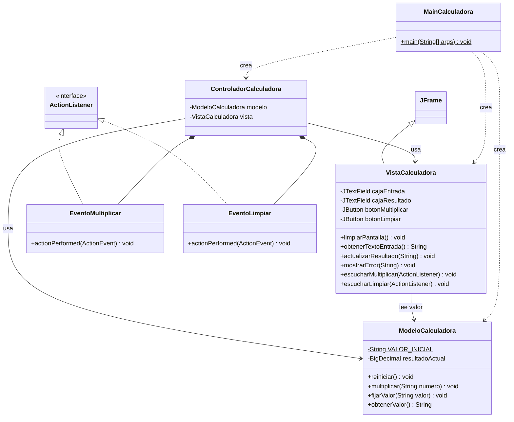
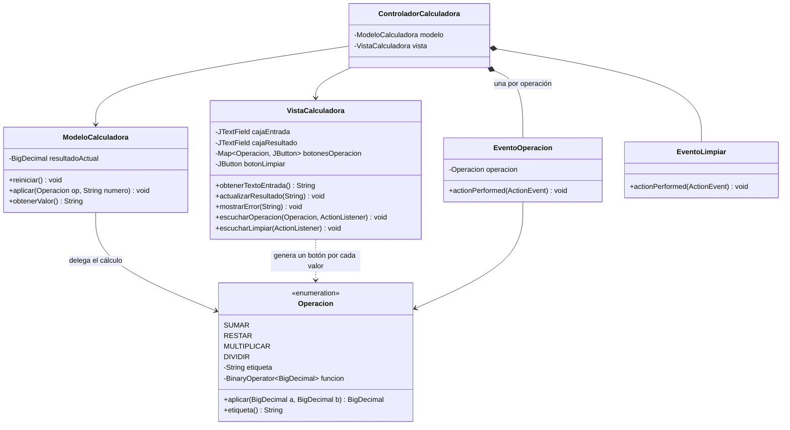

# 2. Diagramas de clases

Los diagramas están escritos en Mermaid, que GitHub renderiza directamente. Los archivos fuente están en la carpeta [diagramas](diagramas/).

## 2.1 Diagrama actual

**Lectura del diagrama:** `VistaCalculadora` extiende `JFrame`; el controlador contiene dos clases internas que implementan `ActionListener`; el controlador usa modelo y vista; la vista lee el valor del modelo; `MainCalculadora` crea las tres piezas.

## 2.2 Diagrama propuesto (con la estrategia recomendada)

**Lectura del diagrama:** aparece el `enum Operacion`; el modelo delega el cálculo en él, la vista genera un botón por cada valor y el controlador usa una sola clase de evento (`EventoOperacion`) parametrizada con la operación.
